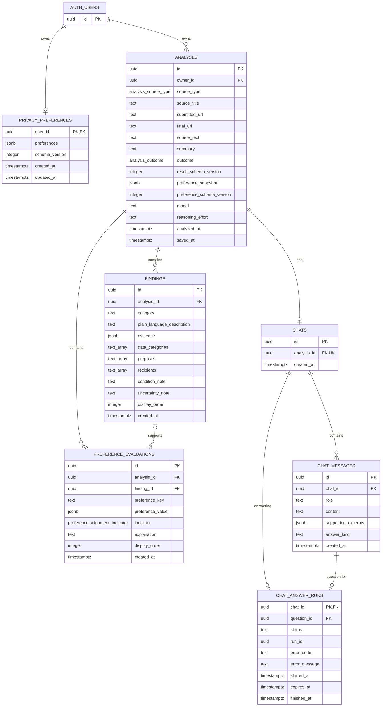

# MVP database design (issue #5)

This document defines the persisted data model for the ClearConsent MVP.
Supabase provides PostgreSQL, authentication, migrations, and row-level
security (RLS). Anonymous URL and pasted-text analyses remain temporary and do
not use these tables.

The schema supports saved privacy preferences, completed agreement analyses,
source-supported findings, personalized preference alignment, analysis history,
and chats for saved analyses.

## Technology choice

ClearConsent uses Supabase PostgreSQL because it provides:

- Relational constraints for analysis ownership and supporting findings.
- Supabase Auth integration through `auth.users`.
- RLS policies based on the authenticated user's `auth.uid()`.
- Version-controlled SQL migrations and reproducible local development.
- An HTTPS Data API compatible with a SvelteKit application deployed on
  Cloudflare.

The application can use the public Supabase client configuration and the
signed-in user's session. A service-role key must never be exposed to browser
code because it bypasses RLS.

## Entity-relationship diagram



`AUTH_USERS` represents the Supabase-managed `auth.users` table. ClearConsent
does not duplicate authentication identity data in a public profile table for
the MVP.

## Table responsibilities

### `privacy_preferences`

Stores at most one current preference set for each authenticated user. The
JSON object allows the preference contract to evolve while `schema_version`
identifies the format used. An `updated_at` trigger records changes.

An absent row means that the user has not configured preferences. Preferences
must be a nonempty JSON object.

### `analyses`

Stores one completed analysis saved by an authenticated user. It preserves the
source text and result summary needed to reopen the result and display
source-linked evidence.

`source_type` distinguishes URL input from pasted text. URL analyses require a
submitted URL. Pasted-text analyses cannot contain submitted or final URLs.

`outcome` distinguishes a result with supported findings from a successful
analysis where no supported practices were identified. This avoids treating an
empty result as a processing failure.

When personalization is performed, `preference_snapshot` and
`preference_schema_version` preserve the exact preference context used for the
result. Both remain null for a non-personalized result.

`model` and `reasoning_effort` record which model and reasoning effort produced
the analysis, so a result reopened later or from history can show them.
`save_analysis` stores them from the completed result. Both are null for
analyses saved before they were recorded, and a row has both or neither.

### `findings`

Stores individual privacy practices supported by the analyzed source. Each
finding includes:

- A category such as collection, use, sharing, retention, or user choice.
- A plain-language description.
- A nonempty array of evidence objects.
- Structured data categories, purposes, and recipients.
- Optional conditions and uncertainty notes.
- A display order for deterministic presentation.

A finding is deleted automatically when its parent analysis is deleted. The
Data Footprint interface is derived from these structured findings rather than
stored as a separate table.

### `preference_evaluations`

Stores the interpretation of a finding against the preference snapshot used
for an analysis. The supported indicators are:

- `alignment`
- `conflict`
- `insufficient_evidence`

These indicators describe preference alignment only. They are not legal
conclusions and must not be presented as safe, unsafe, acceptable, or advice
to accept or reject an agreement.

Alignment and conflict rows must reference a supporting finding.
`insufficient_evidence` may use a null `finding_id` when the source contains no
finding that addresses the preference. A composite foreign key ensures that a
referenced finding belongs to the same analysis.

### `chats` and `chat_messages`

A saved analysis can have at most one chat. Each chat inherits ownership from
its analysis and can contain multiple messages.

Each message has a `user` or `assistant` role and nonblank content. The
`supporting_excerpts` column stores a JSON array and defaults to an empty
array. User messages always have an empty array. Load a chat's messages by
`chat_id`, ordered by `created_at, id`.

Signed-in users can create chats and save questions for their own analyses.
The server can use its service-role credential to save assistant replies. The
chat API must verify ownership with the user's session before using that
credential because the service role bypasses RLS.

The chat API does not use the service-role credential. It asks and answers
through three `SECURITY DEFINER` functions, called with the user's session,
which check ownership against `auth.uid()`:

- `start_chat_answer(analysis_id, question)` creates the chat if needed, saves
  the question, and claims the answer. Without a question, it retries the
  chat's failed question instead of saving it again.
- `save_chat_answer(chat_id, run_id, answer, answer_kind, excerpts)` saves the
  assistant message and clears the run in one transaction.
- `fail_chat_answer(chat_id, run_id, error_code, error_message)` records why
  an answer failed.

`chat_answer_runs` holds each chat's in-progress or failed answer, the same
way `analysis_runs` does for a source. Only one answer per chat can run at a
time, so a double click or second tab cannot start another paid call. A running
answer past `expires_at` (two minutes) counts as failed, and a new question or a
retry can start. A saved answer removes the row. Owners can read their runs
except `run_id`, which only the server that started the answer receives.

`answer_kind` records how the model classified the question it answered:
`answered`, `not_in_policy`, `out_of_scope`, or `legal_advice`. It is null on
questions and is set only through `save_chat_answer`.

## Ownership and access control

RLS is enabled on every public table. Anonymous users have no privileges on
the persisted tables. Analyses completed without an authenticated owner remain
temporary and are not inserted into the persisted tables.

Authenticated access is limited as follows:

| Table                    | Select                 | Insert                 | Update  | Delete           |
| ------------------------ | ---------------------- | ---------------------- | ------- | ---------------- |
| `privacy_preferences`    | Own row                | Own row                | Own row | Own row          |
| `analyses`               | Own rows               | Own rows               | No      | Own rows         |
| `findings`               | Through owned analysis | Through owned analysis | No      | No direct delete |
| `preference_evaluations` | Through owned analysis | Through owned analysis | No      | No direct delete |
| `chats`                  | Through owned analysis | Through owned analysis | No      | No direct delete |
| `chat_messages`          | Through owned chat     | Own questions          | No      | No direct delete |
| `chat_answer_runs`       | Through owned chat     | Chat functions only    | No      | No direct delete |

Saved analyses, findings, evaluations, chats, and messages are immutable to
signed-in users. Deleting an analysis cascades to its findings, preference
evaluations, chat, and messages. Deleting a Supabase Auth user cascades to that
user's preferences and analyses, followed by their child records.

When an authenticated analysis becomes complete, the application assigns one
stable analysis UUID before the first persistence attempt and reuses that UUID
for every retry. The `analyses` primary key therefore acts as an idempotency
key and prevents the same completed result from becoming duplicate history
entries.

The application must save the analysis and all child records atomically. A
failed transaction must roll back every inserted row so incomplete results do
not appear in history. The exact API or database function used for that
transaction remains an implementation decision.

## Retention and deletion

The MVP has no automatic expiration period for saved analyses or their chats.
These records remain until the user deletes their linked source, the analysis,
or their account. This behavior must be communicated in the interface.

Deletion behavior is:

1. Deleting a source removes its linked saved analyses and their child records.
2. Deleting an analysis removes its findings, preference evaluations, chat,
   and messages.
3. Deleting an account removes its preferences, sources, and analyses, including their
   child records.
4. Anonymous source text and question context remain temporary.

A time-based retention policy, export workflow, and scheduled purge process
are deferred until the team establishes product requirements for them.

## Expected query patterns

Load the signed-in user's newest saved analyses:

```sql
select id, source_title, source_type, summary, outcome, saved_at
from public.analyses
where owner_id = auth.uid()
order by saved_at desc;
```

Load findings for one owned analysis:

```sql
select
  id,
  category,
  plain_language_description,
  evidence,
  data_categories,
  purposes,
  recipients,
  condition_note,
  uncertainty_note
from public.findings
where analysis_id = $1
order by display_order, id;
```

Build a basic Data Footprint summary:

```sql
select category, count(*) as finding_count
from public.findings
where analysis_id = $1
group by category
order by category;
```

Load preference-alignment results:

```sql
select
  preference_key,
  preference_value,
  indicator,
  explanation,
  finding_id
from public.preference_evaluations
where analysis_id = $1
order by display_order, id;
```

Delete an owned saved analysis:

```sql
delete from public.analyses
where id = $1
  and owner_id = auth.uid();
```

RLS provides the final ownership check even when an application query omits an
explicit owner filter.

## Synthetic local data

`supabase/seed.sql` creates deterministic, synthetic records for local
development:

- Two UUID-only Auth records that are not login accounts.
- One saved preference set owned by the first user.
- One pasted-text analysis with three source-supported findings.
- Four preference evaluations: one alignment, two conflicts, and one
  insufficient-evidence result.
- No persisted data owned by the second user, allowing RLS isolation checks.

After a reset, the expected counts are:

| Record type            | Count |
| ---------------------- | ----: |
| Auth users             |     2 |
| Preference sets        |     1 |
| Analyses               |     1 |
| Findings               |     3 |
| Preference evaluations |     4 |

## Local setup and verification

Docker Desktop or another Docker-compatible runtime must be running. From the
repository root, start Supabase:

```sh
npx supabase start
```

Recreate the local database, apply all migrations, and load the seed:

```sh
npx supabase db reset
```

Lint the local schema:

```sh
npx supabase db lint --local --level warning --fail-on warning
```

A reset deletes local database changes and reconstructs the database from the
committed migration and seed files. The seed must contain synthetic data only;
credentials, tokens, and production data must never be committed.

Create future schema changes as new migrations:

```sh
npx supabase migration new descriptive_change_name
```

## Verification results

The initial migration was verified locally by:

- Rebuilding the database from an empty local state.
- Loading all synthetic records without constraint or foreign-key errors.
- Running the Supabase database linter with no schema warnings.
- Confirming RLS on all four public tables.
- Confirming the exact authenticated table privileges.
- Confirming the owner sees `1` preference, `1` analysis, `3` findings, and
  `4` evaluations.
- Confirming the second authenticated user sees zero of those rows.
- Confirming the anonymous role receives `permission denied` for persisted
  analyses.

## Deferred decisions

The following decisions require coordination with the shared application and
AI data contracts:

- Final accepted values for finding categories, data categories, purposes, and
  recipients.
- The final evidence-object schema and whether character offsets use bytes,
  Unicode code points, or another indexing convention.
- The final preference JSON schema and its version-migration strategy.
- The atomic persistence boundary for an analysis and all child records.
- Whether saved source text receives a time-based retention limit.
- Whether future versions support result export or account-level bulk deletion.
- When generated TypeScript database types become part of the build process.

Separate profile, uploaded-document, and Data Footprint tables are outside
the MVP. Authentication identity remains in Supabase Auth, each analysis
preserves a source snapshot, and the Data Footprint is derived from findings.

## Evidence validation follow-up

The phase 1 migration requires every persisted evidence element to be an object
with a nonblank string excerpt. It rejects null, empty objects and scalar elements.
The existing synthetic seed remains valid. Additional evidence fields are allowed;
#22 owns the final shared evidence contract. Run `npm run test:db` for disposable
migration/seed/lint and authorization/constraint regression checks.

## Extracted sources (PR2)

The `sources` table stores extracted documents before AI processing.
Each source belongs to an authenticated user and can exist before a completed
analysis.

| Column       | Type        | Requirement                                          |
| ------------ | ----------- | ---------------------------------------------------- |
| `id`         | UUID        | Primary key; generated automatically unless supplied |
| `owner_id`   | UUID        | Required; references `auth.users.id`                 |
| `title`      | text        | Optional extracted title                             |
| `text`       | text        | Required; must contain non-whitespace content        |
| `url`        | text        | Optional final URL after redirects; cannot be blank  |
| `created_at` | timestamptz | Automatically records insertion time                 |

### Extraction integration handoff

The column names `title`, `text`, and `url` match the object returned by
`extractFromUrl()`. The integration must obtain `owner_id` from the verified
authenticated user, rather than trusting an owner ID supplied in the request.
// you can use that Michael if you want.

### Relationship to completed analyses

The `analyses` source fields preserve the source snapshot for a completed
result. `analyses.source_id` links the analysis to its owner's extracted source.
Historical analyses may have a null source link. Deleting a source cascades
to its linked saved analyses and removes their chats and messages.

### Verification

Run `npm run test:db` to apply migrations, load synthetic fixtures, lint the
schema, and run the database tests in a disposable local database.

`sources.test.sql` checks successful insertion and exact text retrieval,
optional metadata, invalid text and URL rejection, ownership isolation,
anonymous access denial, update denial, owner deletion, and account deletion.
`chat-history.test.sql` checks one chat per analysis, ownership isolation,
anonymous access denial, server-only assistant writes, and deletion of chats
and messages when a source or analysis is removed.
`chat-answer-runs.test.sql` checks one answer in progress per chat, saving and
failing only with the current run ID, retries of a failed question, expiry,
answer kinds, ownership isolation, and anonymous access denial.
All test changes are rolled back.
