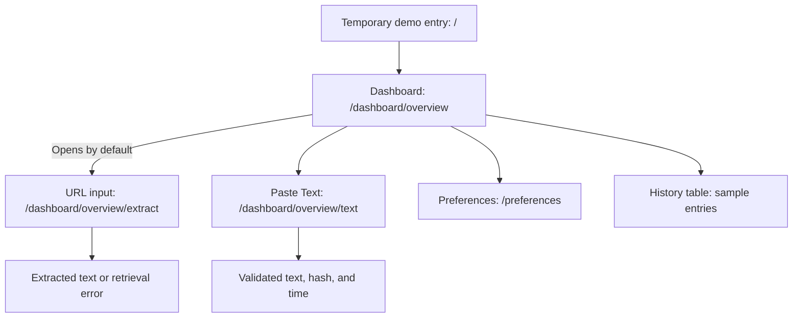
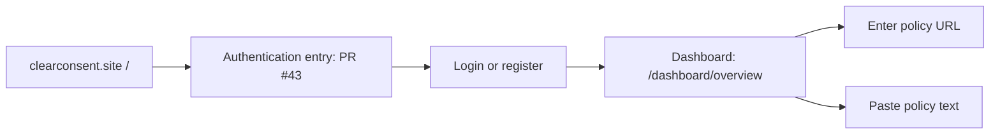
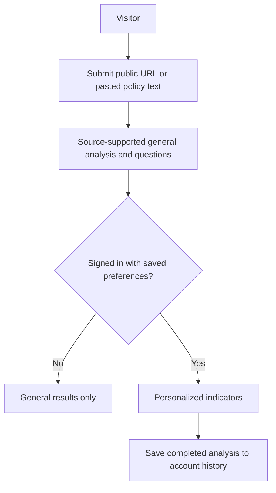

# ClearConsent dashboard navigation for user study

The dashboard at `/dashboard/overview` is the walkthrough screen and now opens the URL input by default. Its URL and Paste Text cards switch between the existing forms. The root `/` has a temporary demo access link to the dashboard until John's authentication entry in PR #43 is integrated.

## Current routes

The entry link opens the dashboard without signing in or saving data. The input forms do not yet produce a complete analysis. The Preferences page offers temporary privacy-topic, detail-level, and answer-style controls. Detail and style change only an illustrative example on that page; no choices are saved or sent to analysis. History rows are sample data. The Stage 1 server analysis endpoint is not connected to the dashboard. Search is a disabled coming-soon card, and history View controls do not lead to working results.

Answer style and detail level are study concepts, not accepted requirements or implemented analysis settings. [FR-8](../requirements/detailed-functional-requirements.md#fr-8--plain-language-summary) requires plain language, source support, and preservation of conditions and uncertainty at every level. The current [Stage 2 contract](../stage-2-consolidation.md#preferences) uses privacy preferences only for relevance and ordering. Connecting presentation choices to real output needs a separate design decision and tests that the underlying findings and evidence stay intact.

## Auth handoff to connect

[Dashboard PR #33](https://github.com/UNLV-CS472-672/2026-F-GROUP2-ClearConsent/pull/33) provides `/dashboard` and redirects it to `/dashboard/overview`. [Auth PR #43](https://github.com/UNLV-CS472-672/2026-F-GROUP2-ClearConsent/pull/43) proposes login and registration from `/`. Its current successful login action redirects back to `/`. The intended handoff is:

The [detailed requirements](../requirements/detailed-functional-requirements.md) also allow unsigned-in visitors to submit a policy and see general analysis. PR #43 currently gates every feature behind login. The team needs to settle the guest path before describing this diagram as the final product flow.

## Intended analysis journey

The [detailed requirements](../requirements/detailed-functional-requirements.md) and DP1 frontend flow describe submission, general results, optional personalization, and history. These steps remain a design target:

DP1 feedback asked the team to distinguish signed-in and unsigned-in paths and describe saving consistently. [UI issue #18](https://github.com/UNLV-CS472-672/2026-F-GROUP2-ClearConsent/issues/18) sketches the page layout.

For a walkthrough before the auth handoff works, start at `/` and use the demo entry. Use the same example policy or policy text for each participant. After auth is connected, start at `/` again to test the real sign-in flow. Record observations of implemented screens separately from reactions to the intended journey.
