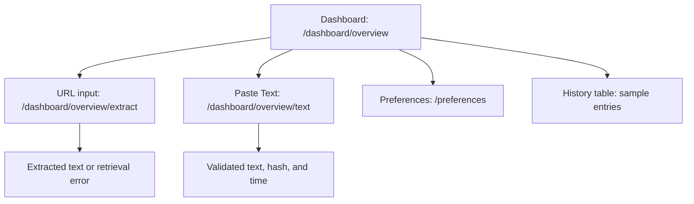
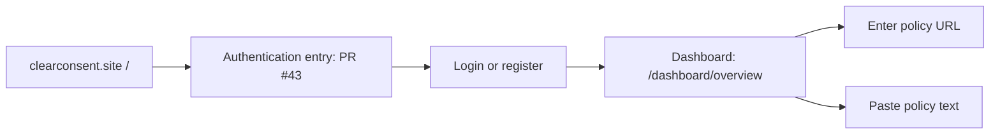
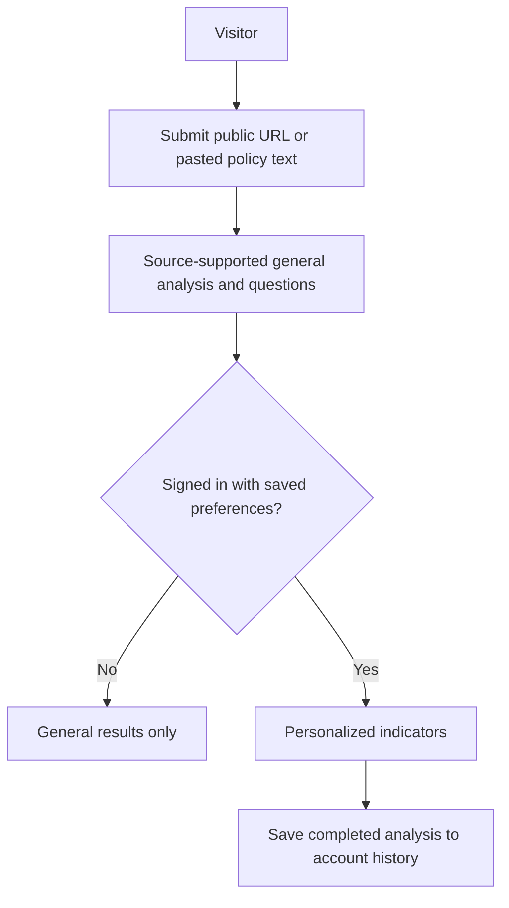

# ClearConsent dashboard navigation for user study

The dashboard at `/dashboard/overview` is the walkthrough screen. Its URL and Paste Text tabs open the existing input forms. The root `/` is reserved for John's authentication entry in PR #43.

## Current routes

The input forms do not yet produce a complete analysis. Preference choices are not persisted, and history rows are sample data. The Stage 1 server analysis endpoint is not connected to the dashboard. Search and history View controls are present in the dashboard but do not lead to working results.

## Auth handoff to connect

[Dashboard PR #33](https://github.com/UNLV-CS472-672/2026-F-GROUP2-ClearConsent/pull/33) provides `/dashboard` and redirects it to `/dashboard/overview`. [Auth PR #43](https://github.com/UNLV-CS472-672/2026-F-GROUP2-ClearConsent/pull/43) proposes login and registration from `/`. Its current successful login action redirects back to `/`. The intended handoff is:

The [detailed requirements](../requirements/detailed-functional-requirements.md) also allow unsigned-in visitors to submit a policy and see general analysis. PR #43 currently gates every feature behind login. The team needs to settle the guest path before describing this diagram as the final product flow.

## Intended analysis journey

The [detailed requirements](../requirements/detailed-functional-requirements.md) and DP1 frontend flow describe submission, general results, optional personalization, and history. These steps remain a design target:

DP1 feedback asked the team to distinguish signed-in and unsigned-in paths and describe saving consistently. [UI issue #18](https://github.com/UNLV-CS472-672/2026-F-GROUP2-ClearConsent/issues/18) sketches the page layout.

For a walkthrough before the auth handoff works, open `/dashboard/overview` directly and use the same example policy or policy text for each participant. After the handoff is connected, start at `/` to test the actual entry flow. Record observations of implemented screens separately from reactions to the intended journey.
