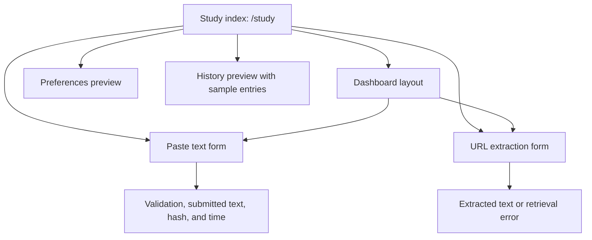
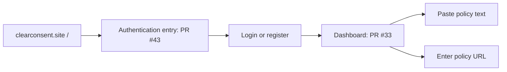
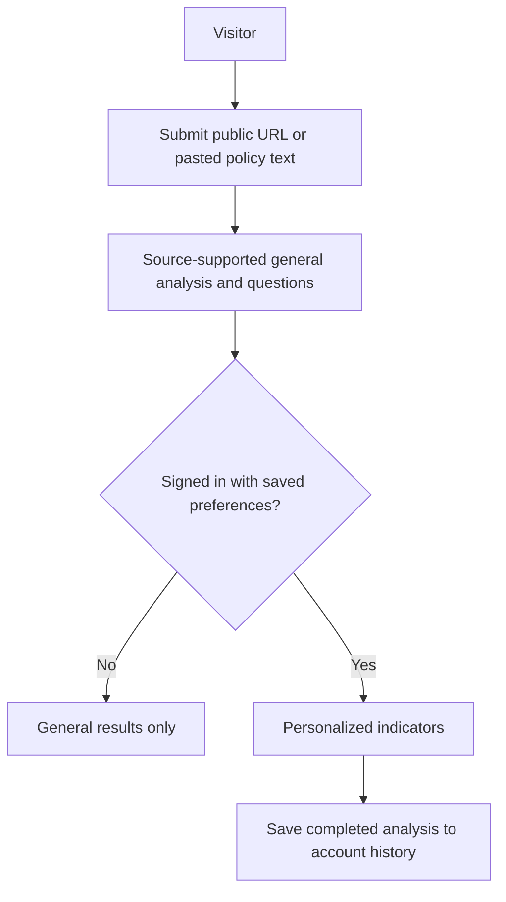

# ClearConsent prototype navigation for user study

This map describes the screens available for participant walkthroughs. It keeps the working prototype
separate from the intended MVP journey so feedback can be reported accurately. The study index lives
at `/study`; the site root `/` is reserved for the authentication entry in John's PR #43.

## Current navigation

The text form is a temporary proof of concept. The URL form depends on a reachable source and working
server configuration. Neither form currently takes a participant to a completed analysis. Preference
choices are not persisted, and the history rows are sample data. The separate Stage 1 server analysis
endpoint is not connected to these screens.

## Proposed site entry and dashboard handoff

[Dashboard PR #33](https://github.com/UNLV-CS472-672/2026-F-GROUP2-ClearConsent/pull/33)
already provides `/dashboard` and redirects it to `/dashboard/overview`.
[Auth PR #43](https://github.com/UNLV-CS472-672/2026-F-GROUP2-ClearConsent/pull/43) proposes
login and registration from `/`. Its current successful login action redirects back to `/`, where it
shows a welcome and logout button. The intended handoff still needs to be wired:

The [detailed requirements](../requirements/detailed-functional-requirements.md) also allow
unsigned-in visitors to submit a policy and see general analysis. PR #43 currently gates every
feature behind login. The team needs to settle the guest path before making auth mandatory for all
participants or describing this diagram as the final product flow.

## Intended analysis journey for design discussion

The [detailed requirements](../requirements/detailed-functional-requirements.md) and the DP1 frontend
flow describe submission, general results, optional personalization, and history. This is a design
target, not a claim that these steps are implemented:

DP1 feedback asked the team to distinguish signed-in and unsigned-in paths and to describe saving
consistently. [UI issue #18](https://github.com/UNLV-CS472-672/2026-F-GROUP2-ClearConsent/issues/18)
sketches the page layout.

For a screen-only walkthrough, use `/study` and the same example policy or policy text. Once the auth
handoff works, start participants at `/` to test the actual entry flow. Describe the result and account
screens as previews, and record observations about current screens separately from reactions to the
intended journey.
